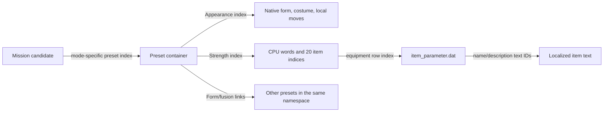

# Presets, item IDs and transformations

## Follow the references, not the visible character name

Galaxy, Tutorial, download/enhanced and Normal/Ultimate Battle Zone have separate
preset containers. They share Appearance/Strength tables. A participant's preset
number is not a global character ID. Changing a shared row affects every preset
that points at it. An isolated custom fighter needs dedicated rows and explicitly
linked destinations. A growing DAT also requires a repacker that preserves neighbors.

Example original Goku/Saibamen mission 246: five candidates use Galaxy preset 519,
Appearance 174, native 74, Strength 330. Preset 519 also occurs in mission 315.
The user's successful G04 health-item test established that this preset equipment
path affects actual combat; it did not prove every transformation item.

## Selected main player is a separate setup path

The selected Galaxy main player does not take the same starting Appearance path
as preset allies/enemies. Stock code explicitly passes costume0 for side0/slot0;
changing an unrelated Appearance row will not change that argument. See the
[19 October costume investigation and executable roadmap](EBOOT_PATCH_ROADMAP.md)
for the traced config/actor path, minimal patch candidate and runtime scope.

## Why the two item lists misled the investigation

The supplied save-editing/community labels were not a reliable equipment-index
dictionary. The other PDF's item IDs match **name-text IDs**, not another index
that can be written directly into equipment slots. Rebuilding original texts
through `item_parameter.dat` resolved the ambiguity. Some labels were shifted after
omitted entries; repeated text IDs and placeholders prevent a universal offset fix.

Example: equipment index `0x155` points to name-text 604 / `0x25C`, description 718:
**second transformation entry at two bars**, not first transformation at three bars.
The stock Gohan control duplicated its first two destination links, masking the
mistaken slot interpretation. Use [the English catalog](item-catalog-BLES00978-EN.csv)
and its [provenance](item-localization-provenance-EN.json).

| Equipment index, hex | Intended family |
|---|---|
| 151 / 152 / 153 | Native entry 0 at 1 / 2 / 3 health bars |
| 154 / 155 / 156 | Native entry 1 at 1 / 2 / 3 bars |
| 157 / 158 / 159 | Native entry 2 at 1 / 2 / 3 bars |
| 15A / 15B / 15C | Cancel transformation at 1 / 2 / 3 bars |
| 15D / 15E / 15F | Switch teammate at 1 / 2 / 3 bars |
| 160 / 161 | Raging Soul / High Tension entry after a preceding KO |
| 169 / 16A | No Transformations / No Switch-Outs for ordinary actions; descriptions permit item-induced effects |
| AD | Max Computer / CPU MAX |

These are equipment-array indices, not item property-bit numbers or localized text
IDs. A localized description establishes intended behavior; a gameplay trigger
needs its own control. A normal switch does not satisfy a KO-entry condition.

## Two independent transformation layers

Native form slots define the requested action, animation, cancellation flag and
cost. Preset links identify the destination preset's Appearance and Strength.

For **Goku SSJ2 / native 2**, slot 0 is base/cancellation; slot 1 is SSJ3/normal
transformation. Assigning item 0x153 while pointing preset slot 0 at SSJ3 requested
a cancellation action with SSJ3 as destination. The user observed exactly that
wrong animation followed by the requested SSJ3 identity. It was not evidence of
random animation corruption or that the game ignored the preset.

The corrected KB15B control used **0x156**, three bars on slot 1. At matched
29,000 HP/aura 50 it requested slot 1, reached native 3/preset 1059 and consumed
30 aura. At 19,000 HP SSJ3 requested cancellation slot 0 and reached base/preset
1060, loading the base's nine equipment entries. The base link already existed;
its absence was not the established cause of the preceding failure.

That controlled session started from KB15A with a logged resident-link correction;
the complete resident tables were compared with KB15B. Do not describe it as an
untouched cold boot of the final archive. Details and observation limits are in
[KB15 native-slot analysis](KB15_NATIVE_SLOTS_AND_TAG_ORDER.md) and its linked JSON.

The native-slot catalog is [NATIVE_FORM_SLOTS_BLES00978.csv](NATIVE_FORM_SLOTS_BLES00978.csv).
Slot order in the UI diamond is left, top, right, bottom; fusion has its own diamond.
A fourth editable link is not proof that any arbitrary native fourth action works.

## Equipment and moves after a form change

Each destination preset can load different equipment and move selectors. Cancellation
does **not** universally retain the previous preset. Appearance's five local selectors
are Up, Right, Down, Left and Ultimate/Push. Move indices belong to that native form;
changing them does not transplant another character's animations or projectiles.
The catalog has 690 name bindings, 666 consistent HUD/pause bindings and 24 unresolved
entries; consistent names are not a casting test of every move/category combination.

CPU MAX worked in the later heavy loadout. Empty equipment slots were permitted.
Neither filling all slots nor removing CPU MAX was established as a prerequisite.
Earlier negative tests often used wrong item labels, wrong native entries or a
different archive revision. Keep those confounders visible.

The actor's equipped-property bits and its filtered working-property copy are also
separate. A 72-byte-per-entry exclusion metadata table feeds the working copy at
actor +2364; it is not the 84-byte item definition table. In the KB13 control the
examined CPU MAX, defense and flow-property exclusion masks were empty and the bits
remained in the working copy. This did not establish a CPU MAX conflict. Old dump
reports can contain a mislabeled first-transform-three-bars boolean: the corrected
reader uses property E2, not D2. Raw equipped indices/bit words take precedence over
that old derived label. See `property-metadata-selected.json` and the snapshot tool.

Retry can reuse a cached actor configuration. One resident Strength change appeared
only after retiring to mission selection and relaunching, not through Retry. Leaving
Galaxy for Single Player also retained a previously loaded MAIN in one observed
session after an archive replacement. A file's disk hash does not certify live RAM;
use complete restarts and verify loaded identities. Intro-phase writes can be reset
before combat, and host seconds under software rendering are not game-time latency.

## Switch timing is not switch destination

Goku base's switch item fired at one bar but selected Fat Buu in party slot 2 while
Vegeta in slot 1 was alive. The native request uses a separate CPU-selected ordinal
and party lookup (`8A31C`, `AC8AC`, `8A35C` → `3A9A4`), rather than form links.
No verified arbitrary ordered-partner field in MMD has been found. The user fixed
their intended flow by changing roster order, then requested a two-fighter version
with No Switch-Outs. Their theory about the last transformation button is unproven.

Final historical KB17A removed Buu from the roster and retained form-specific items.
Archive readback was checked; that final delivered archive was not replayed here.
See [history](EXPERIMENT_HISTORY.md) instead of treating every delivered build as a
fully played test.
